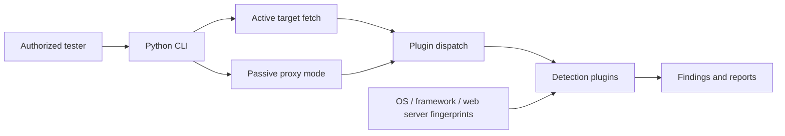

# YGscan — Web Vulnerability Assessment Research Toolkit

**YGscan** is a Python-based web security scanning toolkit that combines **active HTTP assessment** with a **passive interception/proxy mode**. The codebase contains detection plugins and fingerprinting modules for common web technologies and vulnerability classes.

> **Attribution:** this repository contains a customized/repackaged version of the community YGscan scanner, not an independently written scanner from scratch. Upstream and contributor acknowledgements are maintained in [CONTRIBUTORS.md](CONTRIBUTORS.md). When citing this work in a CV or interview, clearly distinguish upstream functionality from changes, packaging, testing and documentation you personally contributed.

> **Research status:** legacy toolchain; compatibility, detection accuracy and dependency security have not been independently verified for current Python releases. Only test systems you own or are explicitly authorized to assess.

## 1. Scope and learning objectives

YGscan is useful for studying:
- request/response analysis and how HTTP vulnerability scanners work;
- modular detection plugins and technology fingerprints;
- active scanning versus passive proxy-assisted traffic analysis;
- false positives, evidence capture and vulnerability reporting;
- adapting and validating an existing open-source security project.

The tool may produce false positives or incomplete findings and is **not a substitute for a professional penetration test**.

## 2. Architecture



### Scanning modes

| Mode | Input | Behavior |
| --- | --- | --- |
| Active | `-u URL` or `-f file` | Fetch allowed target URLs and dispatch detection modules |
| Passive | `-s host:port` | Inspect HTTP(S) traffic through the configured proxy |
| Plugin control | `--able`, `--disable` | Select subsets of detection modules |
| Reporting | `--html`, `--json` | Configure output generation where implemented |

Features vary by plugin; a module's presence is not evidence that it will detect all instances of a vulnerability.

## 3. Repository layout

```text
.
├── YGscan/
│   ├── ygscan.py             # CLI entry point
│   ├── lib/
│   │   ├── parse/cmdparse.py # Command-line arguments
│   │   ├── controller/       # Scan scheduling and plugin dispatch
│   │   └── proxy/            # Passive traffic capture
│   ├── fingprints/           # Technology, OS and server fingerprints
│   └── ...                   # Detection modules and helper libraries
├── tests/                   # Existing test materials
├── Dockerfile               # Python 3.11 image with corrected working directory
├── requirements.txt         # Updated constrained dependencies
├── CONTRIBUTORS.md          # Upstream credits and inspirations
└── README.md
```

**Note:** `fingprints` is the directory name currently used by the project; it is not a spelling correction in this documentation.

## 4. Getting started safely

**Prerequisites:** Python 3 and a disposable, isolated environment (virtual machine or container); a deliberately vulnerable training application hosted locally; written authorization for any scan.

The Dockerfile has been revised to use **Python 3.11**, install bounded dependency versions, copy the actual `YGscan/` source directory, run as a non-root user and start with `--help` by default. A no-network smoke-check workflow has also been added. **Build success has not yet been independently verified here.**

### Inspect the source and CLI

```bash
git clone https://github.com/gaddah-yousef/YGscan.git
cd YGscan
python -m venv .venv
# Linux/macOS: source .venv/bin/activate
# Windows: .venv\Scripts\Activate.ps1
python -m pip install -r requirements.txt
python YGscan/ygscan.py -h
```

**Compatibility warning:** the constraints have been modernized, but the scanner's legacy upstream modules can still require source-code changes. Install and test **only in an isolated environment**; check GitHub Actions smoke results and dependency advisories before use.

### Docker: build and inspect CLI safely

```bash
docker build -t ygscan:local .
docker run --rm --network none ygscan:local --help
```

To assess **only your own isolated target**, explicitly enable the appropriate lab network and pass `-u http://<authorized-lab-host>/`. The image does **not** scan any target automatically.

### Example active scan against a locally controlled target

```bash
# Replace with a training service hosted on your own machine.
python YGscan/ygscan.py -u http://127.0.0.1:8080/
```

### Example proxy-mode invocation (local-only)

```bash
python YGscan/ygscan.py -s 127.0.0.1:7778 --html
```

Connect a **test browser** to the proxy only in a controlled environment. HTTP(S) interception may expose credentials or cookies; do not route personal browsing sessions through the lab proxy.

**Execution status:** these are code-informed examples, not commands validated by a successful end-to-end test during this documentation update.

## 5. Detection modules and investigative value

The code includes modules related to:
- cross-site scripting and injection patterns;
- SQL injection indicators;
- path traversal and sensitive file exposure;
- HTTP request smuggling cases;
- deserialization and server/framework-specific security checks;
- fingerprinting of technology families.

A well-structured assessment should record the tested endpoint, request characteristics, observed responses, false-positive review, impact and remediation suggestions. Findings should be verified manually before assigning a confirmed vulnerability.

## 6. Known issues and technical debt

| Area | Observation | Recommended action |
| --- | --- | --- |
| Python packaging | Bounded constraints updated for Python 3.11; legacy modules remain | Verify dependency compatibility and audit packages |
| Container | Directory corrected and non-root image created | Confirm build and smoke results in CI |
| Attribution | Scanner derives from community code | Preserve upstream credits and document personal contributions |
| Testing | Python compile/CLI and Docker smoke workflow added | Verify the workflow, add offline plugin-level fixtures |
| Scanning ethics | Active probes may affect target applications | Restrict scope, rate-limit and use local labs |
| Reproducibility | Examples historically used an external demo target | Use a deterministic locally hosted fixture |

## 7. Recommended roadmap

1. Confirm the Python 3.11 CLI and Docker smoke workflow pass in GitHub Actions.
2. Audit updated dependencies and lock tested versions for reproducibility.
3. Introduce offline HTTP fixtures for representative plugins.
4. Add plugin-level unit tests, linters and dependency audits.
5. Normalize reports (severity, confidence, proof/evidence and remediation).
6. Create a transparent change log distinguishing **upstream**, **modified**, and **original** modules.

## 8. Portfolio positioning

**Relevant roles:** Pentest Intern · Application Security Intern · Security Tooling Engineer.

**Skills that can be discussed:** Python security tooling, HTTP protocol analysis, plugin architecture, request/response inspection, vulnerability validation, container packaging and ethical assessment practices.

**Maintainer:** [Yousef Gaddah](https://github.com/gaddah-yousef) · See [contributors](CONTRIBUTORS.md) for upstream acknowledgements.
